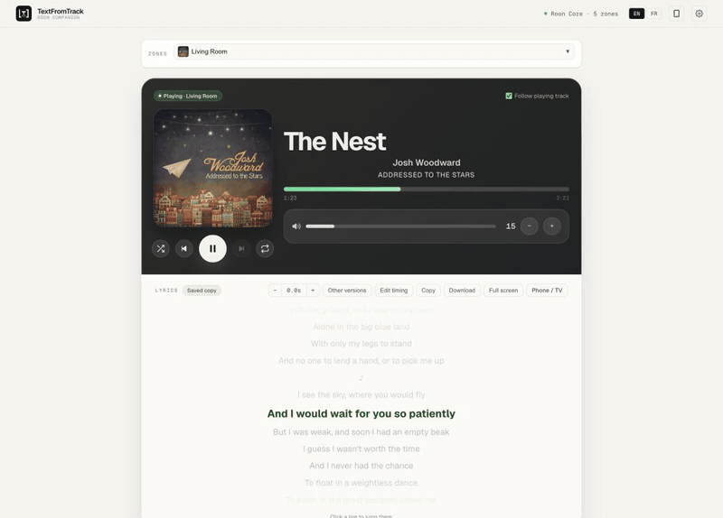
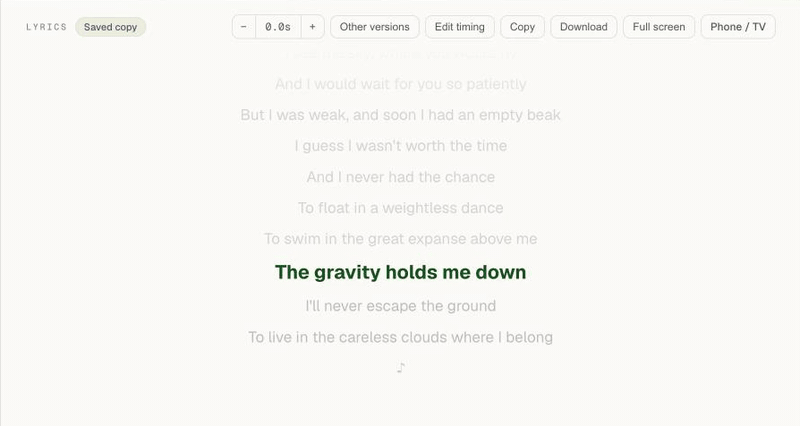
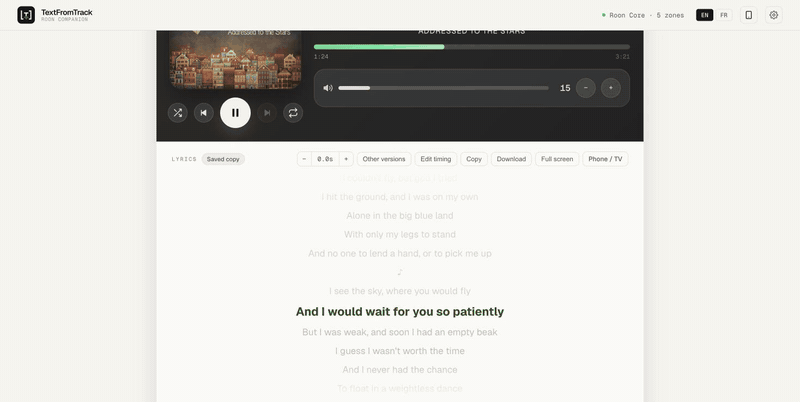
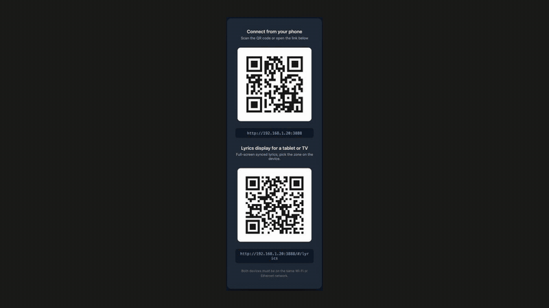

<div align="center">

# TextFromTrack Roon Companion

**Roon plays it. You sing along — synced lyrics for everything Roon plays.**


[](https://github.com/r45635/roon.app.textfromtrack.com/releases/latest)
[](https://hub.docker.com/r/r45635/roon-companion)

[](LICENSE)

</div>

Roon shows you the album, the credits, the reviews — but not the words as they're sung.
**TextFromTrack Roon Companion follows a Roon zone and shows the lyrics line by line, in time
with the music**: Qobuz, TIDAL, radio or your own files. Click a line and Roon jumps there.
Put the lyrics full screen, on your phone, or on a tablet on the shelf.

**Nothing to set up.** No music folder, no account: install it, enable it in Roon, press play.

## Get it

| | |
|---|---|
| **Mac** | [Apple Silicon `.dmg`](https://github.com/r45635/roon.app.textfromtrack.com/releases/latest) · [Intel `.dmg`](https://github.com/r45635/roon.app.textfromtrack.com/releases/latest) |
| **Windows** | [Installer `.exe`](https://github.com/r45635/roon.app.textfromtrack.com/releases/latest) |
| **Linux** | [`.AppImage` or `.deb`](https://github.com/r45635/roon.app.textfromtrack.com/releases/latest) |
| **NAS / server** | Docker, amd64 and arm64 — see below |

```bash
docker run -d --name roon-companion --network host --restart unless-stopped \
  -v "$PWD/data:/app/src/storage" ghcr.io/r45635/roon-companion
```

<sub>Or `docker compose up -d` with the [docker-compose.yml](docker-compose.yml). The image is also on Docker Hub: `r45635/roon-companion`.</sub>

Then in Roon: **Settings → Extensions → TextFromTrack Roon Companion → Enable**, and open
`http://localhost:3888`. Five minutes, step by step: **[quick start](docs/quickstart.md)** ·
[en français](docs/quickstart.fr.md)

---

## Lyrics that follow the music

<table>
<tr>
<td width="50%" align="center"></td>
<td width="50%" align="center"></td>
</tr>
<tr>
<td><b>Click any line</b> and Roon seeks there. The highlighted line glides along with the song,
instrumental breaks show as ♪.</td>
<td><b>A version runs early or late?</b> Nudge the timing by half a second; it's remembered for
that track. Wrong lyrics? <b>Other versions</b> lets you pick another.</td>
</tr>
</table>

Lyrics come from [LRCLIB](https://lrclib.net), a free community database. They're fetched the
moment a track starts and kept, so the next play is instant. Copy them, or download a `.lrc`.

## Full screen, phone, tablet, TV

<table>
<tr>
<td width="50%" align="center"></td>
<td width="50%" align="center"></td>
</tr>
<tr>
<td><b>Press F</b>: big lines over the blurred cover, with the transport at hand.</td>
<td><b>Scan a QR code</b> to get the app on your phone, or turn a tablet or a TV browser into a
lyrics display. Each screen follows its own zone and stays awake.</td>
</tr>
</table>

## A remote for every zone


The player mirrors the zone you follow: cover, progress, volume (dB or steps), shuffle and
repeat. Open the zone menu to see what every zone plays, switch, **transfer the queue** or
**group speakers**. Light or dark theme, keyboard and touch friendly.

<br clear="right">

## Your library, if you want

Point the companion at your music folder and it does more:

- **Write lyrics into your files** — a `.lrc` next to the track, or embedded in MP3 / FLAC tags
  (every other tag and the artwork are kept, with an optional backup).
- **Fill your whole library** from LRCLIB in one batch, without ever replacing lyrics you have.
- **Sync lyrics yourself**: press Space on each line while Roon plays.
- **AI lyrics** for the songs no one has transcribed, with [TextFromTrack](https://app.textfromtrack.com) (paid credits).

## Private and local

- **It runs on your machine or your NAS**, next to your Roon Core. No account, no cloud of its own.
- **Only the track's title, artist, album and length** go to LRCLIB to find lyrics. Your files go
  to TextFromTrack only if you ask for AI lyrics.
- **Screenshot mode** replaces your Core, zone and speaker names, account and folders with neutral
  ones, to share screenshots and bug reports safely. Every picture here was taken with it.
- Other devices can be asked for an **access token**; the update check can be turned off.

---

## User guide

| | |
|---|---|
| 🚀 **Quick start** | [Five minutes to synced lyrics](docs/quickstart.md) · [en français](docs/quickstart.fr.md) |
| 🎤 **The player** | [Lyrics, timing, versions, full screen, phone / tablet / TV, zones](docs/guide/player.md) · [en français](docs/guide/player.fr.md) |
| 📚 **Your library** | [Full user guide](docs/user-guide.md) — music folder, library lyrics, LRC editor, tags, AI lyrics |
| 📦 **Install in depth** | [Installation guide](docs/install.md) — Docker on a NAS, Node.js, every option |
| 🩺 **Something's off?** | [Troubleshooting](docs/quickstart.md#doesnt-work) · [open an issue](https://github.com/r45635/roon.app.textfromtrack.com/issues) |

## Good to know

- **Requirements:** a Roon 2.x Core, and the companion on the same network (or `ROON_CORE_HOST`
  pointing at the Core).
- **Lyrics coverage:** LRCLIB is community-built — most popular songs are there, rare ones may not be.
- **macOS:** the app isn't notarized yet — the first launch needs *Open Anyway* in System Settings →
  Privacy & Security, then *Allow* for Local Network access.
- **Languages:** English and French.
- **Settings for Docker and servers:** [every environment variable](docs/DEVELOPMENT.md#environment-variables).
- **Not affiliated with Roon Labs.** Roon is a trademark of Roon Labs.

<sub>Curious how it works, or want to hack on it? Node.js + React + Electron —
**[the development guide](docs/DEVELOPMENT.md)**: architecture, running from source, API, roadmap.</sub>

## Author

Made by **Vincent Cruvellier** ([@r45635](https://github.com/r45635)). Ideas and bug reports are
welcome — open an [issue](https://github.com/r45635/roon.app.textfromtrack.com/issues).

**Like it?** A ⭐ helps other Roon listeners find it — or share it on
[X](https://twitter.com/intent/tweet?text=TextFromTrack%20Roon%20Companion%3A%20synced%20lyrics%20for%20everything%20Roon%20plays%20%E2%80%94%20line%20by%20line%2C%20full%20screen%2C%20on%20your%20phone%20or%20TV.%20Free%20and%20open%20source.&url=https%3A//github.com/r45635/roon.app.textfromtrack.com),
[Bluesky](https://bsky.app/intent/compose?text=TextFromTrack%20Roon%20Companion%3A%20synced%20lyrics%20for%20everything%20Roon%20plays%20%E2%80%94%20line%20by%20line%2C%20full%20screen%2C%20on%20your%20phone%20or%20TV.%20Free%20and%20open%20source.%20https%3A//github.com/r45635/roon.app.textfromtrack.com),
[Reddit](https://www.reddit.com/submit?url=https%3A//github.com/r45635/roon.app.textfromtrack.com&title=TextFromTrack%20Roon%20Companion%20%E2%80%94%20synced%20lyrics%20for%20everything%20Roon%20plays%20%28free%2C%20open%20source%29) or
[LinkedIn](https://www.linkedin.com/sharing/share-offsite/?url=https%3A//github.com/r45635/roon.app.textfromtrack.com).
Writing about it? Pictures, clips and descriptions are in the [press kit](docs/PRESS.md).

## License

MIT — see [LICENSE](LICENSE). © 2025–2026 Vincent Cruvellier.

<sub>Screenshots and clips show songs by Josh Woodward — "The Nest", "My Favorite Regret", "Wake Up" —
licensed CC BY 4.0, free download at [joshwoodward.com](https://www.joshwoodward.com/).</sub>
