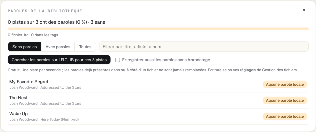
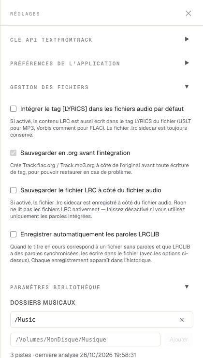
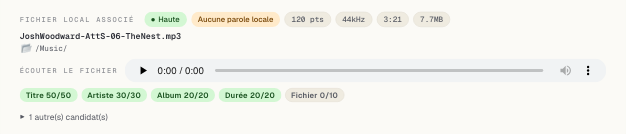
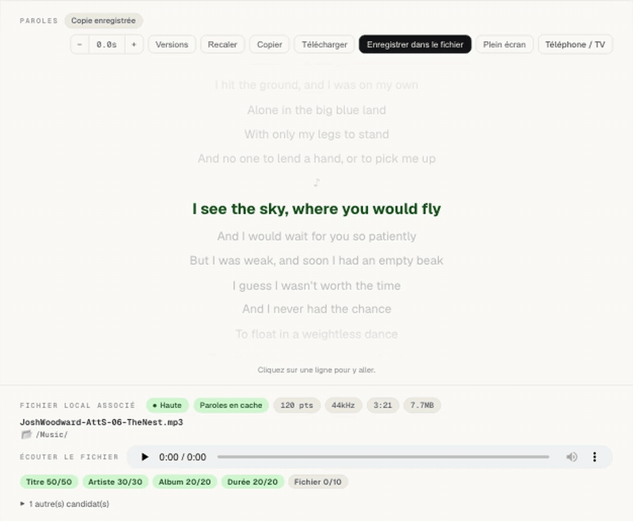
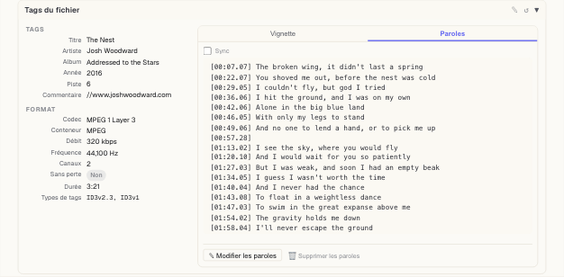
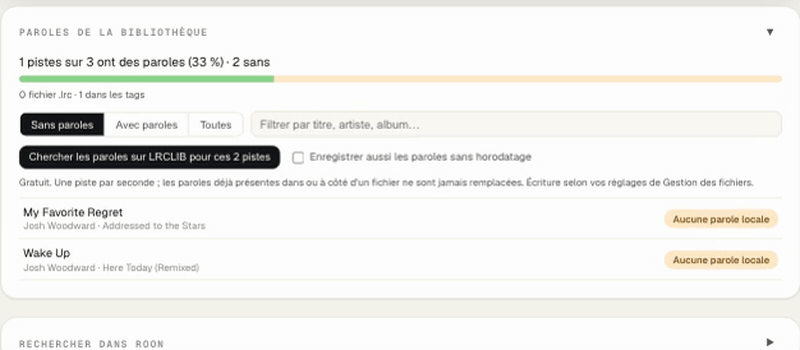
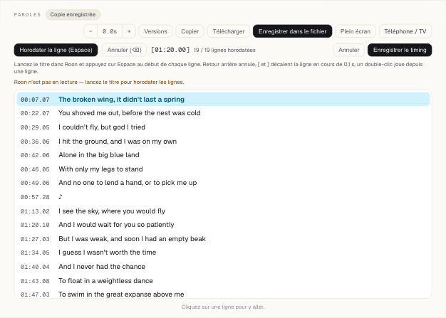
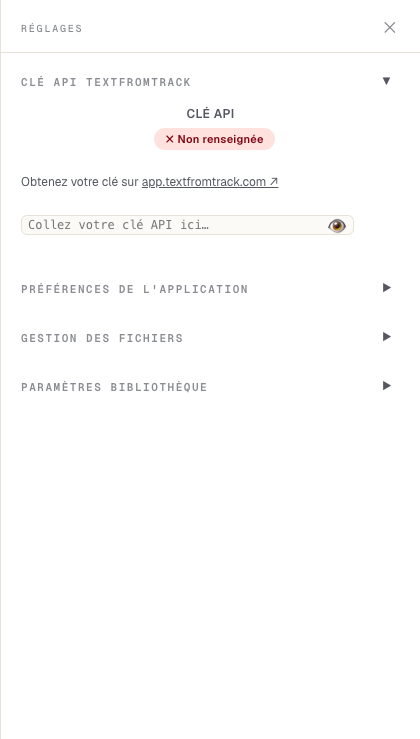
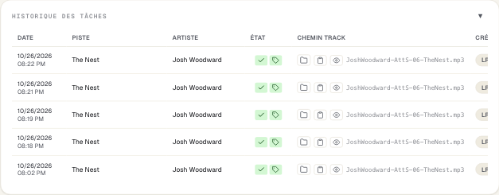

# Votre bibliothèque — les paroles dans vos propres fichiers

*English: [library.md](library.md) · Le lecteur : [player.fr.md](player.fr.md) · Installation : [démarrage rapide](../quickstart.fr.md)*

Le lecteur affiche les paroles de tout ce que joue Roon sans toucher à vos fichiers. Si votre
musique est sur cet ordinateur, sur un NAS ou un disque que le compagnon peut atteindre,
indiquez-lui ce dossier : il peut alors aussi **écrire les paroles dans les fichiers eux-mêmes**,
combler les manques de toute la bibliothèque, synchroniser des paroles à la main et générer
celles qui manquent avec l'IA.

## Indiquer votre musique

Réglages (roue dentée) → **Paramètres bibliothèque** → ajoutez votre dossier musical →
**Enregistrer & Rescanner**.

- Sur Mac ou PC, utilisez le dossier tel que vous le voyez (par exemple `/Volumes/Musique` pour un
  partage NAS). Avec Docker, montez-le dans le conteneur (`:rw` pour écrire les paroles) et
  ajoutez le chemin côté conteneur, comme `/music`.
- L'analyse lit les tags de chaque piste et garde un index ; la ligne d'état indique combien de
  pistes ont été trouvées et quand. Relancez l'analyse après avoir ajouté de la musique. Un disque
  en veille ou débranché est signalé, et l'index précédent est conservé.
- Seuls les fichiers MP3 et FLAC peuvent recevoir les paroles dans leurs tags ; les autres formats
  reçoivent un fichier `.lrc`.

**Sur Mac**, la première analyse d'un partage réseau ou d'un disque externe fait demander à macOS
si *TextFromTrack Companion* peut accéder aux fichiers de ce volume : cliquez sur **Autoriser**.
Tant que vous n'avez pas répondu, l'analyse attend, et les Paramètres bibliothèque l'indiquent. Si
vous avez manqué la fenêtre : Réglages Système → Confidentialité et sécurité → Fichiers et
dossiers → TextFromTrack Companion → activez *Volumes réseau* (ou *Volumes amovibles*). L'app n'est
pas encore signée par Apple : macOS redemande après chaque mise à jour.

**Gestion des fichiers** décide comment les paroles sont écrites :

| Option | Effet |
|---|---|
| Intégrer le tag [LYRICS] | Écrit les paroles dans les tags du fichier (ID3v2 pour MP3, Vorbis comment pour FLAC). C'est le choix par défaut si rien d'autre n'est coché. |
| Sauvegarder en .org | Copie l'original en `Titre.mp3.org` / `Titre.flac.org` avant la première modification. Activé par défaut. |
| Sauvegarder le fichier LRC à côté du fichier audio | Écrit un `Titre.lrc` à côté du morceau, pour les lecteurs qui les lisent. |
| Enregistrer automatiquement les paroles LRCLIB | Quand le titre en cours n'a pas de paroles et que LRCLIB en a des synchronisées, les écrit sans demander. Désactivé par défaut. |

**Roon et vos paroles.** Roon lit les paroles intégrées aux tags de vos fichiers : dans les
paramètres de bibliothèque de Roon, réglages d'importation (en anglais : *Settings → Library →
Import settings*), réglez les paroles et les paroles synchronisées (*Lyrics*, *Synchronized
lyrics*) sur la préférence au fichier (*Prefer file*), puis laissez Roon réanalyser. Ne comptez pas sur Roon
pour lire les fichiers `.lrc` posés à côté des morceaux.

## Le titre en cours et son fichier

Quand le titre que joue Roon est dans votre bibliothèque, le lecteur affiche sous les paroles le
fichier associé : nom, dossier, format et un badge de confiance. **Écouter le fichier** le joue
dans votre navigateur, pour vérifier que c'est le bon.

L'association compare titre, artiste, album, durée et nom de fichier (survolez un score pour voir
son calcul). Avec une confiance *moyenne* ou *faible*, vérifiez le fichier avant d'enregistrer ;
la génération IA demande une confirmation. **Autre(s) candidat(s)** permet d'en choisir un autre.

## Enregistrer les paroles dans le fichier

Avec un fichier associé, **Enregistrer dans le fichier** écrit les paroles affichées — avec votre
décalage appliqué — dans le morceau. Le badge passe à *Dans les tags*, et Roon les affiche après
sa prochaine analyse. **Tags du fichier**, sous l'association, montre ce que contient désormais le
fichier : ses tags, sa vignette et ses paroles, que vous pouvez aussi modifier ou supprimer là.

## Remplir toute la bibliothèque

La carte **Paroles de la bibliothèque** compte les pistes qui ont des paroles (dans leurs tags ou
dans un fichier `.lrc`) et celles qui n'en ont pas. Filtrez avec *Sans paroles / Avec paroles /
Toutes* ou cherchez par titre, artiste ou album, puis **Chercher les paroles sur LRCLIB pour ces
pistes**.

- Il tourne en arrière-plan, une piste par seconde, et vous pouvez l'arrêter.
- Il **ne remplace jamais** les paroles qu'un fichier a déjà.
- Les paroles sans horodatage sont ignorées, sauf si vous cochez *Enregistrer aussi les paroles
  sans horodatage*.
- Quand LRCLIB est surchargé, il attend et le dit ; le résumé compte ce qui a été enregistré, non
  trouvé, ignoré ou en échec. (Les enregistrements d'un lot n'apparaissent pas dans l'historique,
  pour qu'une grande bibliothèque ne l'inonde pas.)

## Synchroniser vous-même

LRCLIB a les paroles mais pas le rythme ? Ou le rythme est faux ? **Synchroniser** (paroles
simples) ou **Recaler** (paroles synchronisées) ouvre l'éditeur. Lancez le titre dans Roon et
appuyez sur **Espace** au début de chaque ligne.

| Touche | Effet |
|---|---|
| Espace | Horodate la ligne en cours avec la position de lecture et passe à la suivante |
| Retour arrière | Annule le dernier horodatage |
| [ et ] | Décalent la ligne en cours de 0,1 s |
| ↑ et ↓ | Passent à la ligne précédente ou suivante |
| Double-clic sur une ligne | Joue à partir de cette ligne |
| Échap | Quitte l'éditeur sans enregistrer |

**Enregistrer le timing** garde le résultat comme paroles du titre ; avec un fichier associé,
**Enregistrer dans le fichier** les écrit ensuite dans le morceau.

## Des paroles IA pour le reste

Pour les morceaux que personne n'a transcrits, [TextFromTrack](https://app.textfromtrack.com)
écoute le fichier et écrit des paroles synchronisées. Créez-y une clé API, collez-la dans
Réglages → **Clé API TextFromTrack**, et **Générer les paroles avec TextFromTrack** apparaît sous le
fichier associé. Cela utilise des crédits de votre compte TextFromTrack (le solde s'affiche dans
les Réglages) ; le résultat est enregistré avec vos options de Gestion des fichiers et listé dans
l'historique.

## Historique des tâches

Chaque enregistrement de paroles depuis le lecteur — LRCLIB, IA, automatique — est une ligne de
l'**Historique des tâches** : quand, quel titre, d'où viennent les paroles, et des boutons pour
les voir ou les copier, ouvrir le dossier ou relancer.

## Bon à savoir

- **Annuler une écriture :** renommez `Titre.mp3.org` en `Titre.mp3` (ou `.flac`).
- **Docker :** un volume musical monté en `:ro` peut être lu mais pas écrit — le message le dit.
- **Les grandes bibliothèques** s'analysent en arrière-plan ; l'interface et Roon continuent de
  fonctionner pendant ce temps.
- **Vos tags sont préservés :** écrire des paroles ne modifie que le cadre des paroles (MP3) ou le
  commentaire LYRICS (FLAC) ; tous les autres tags et la vignette sont recopiés tels quels, et
  vérifiés après l'écriture.
- **Le mode capture d'écran** (Préférences de l'application) masque vos dossiers : les chemins
  s'affichent en `/Music/…`.

---

*Les captures montrent des chansons de Josh Woodward — « The Nest », « My Favorite Regret »,
« Wake Up » — sous licence CC BY 4.0. Téléchargement gratuit : https://www.joshwoodward.com/.
Sans lien avec Roon Labs.*
