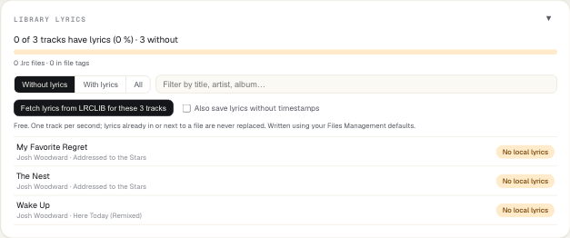
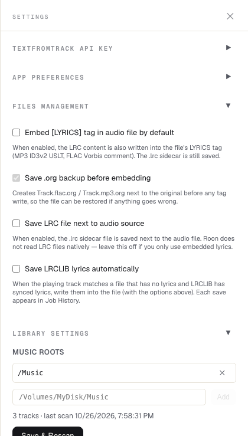
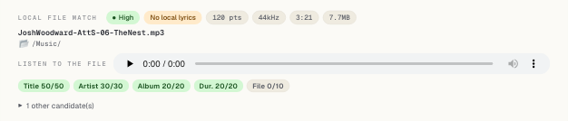
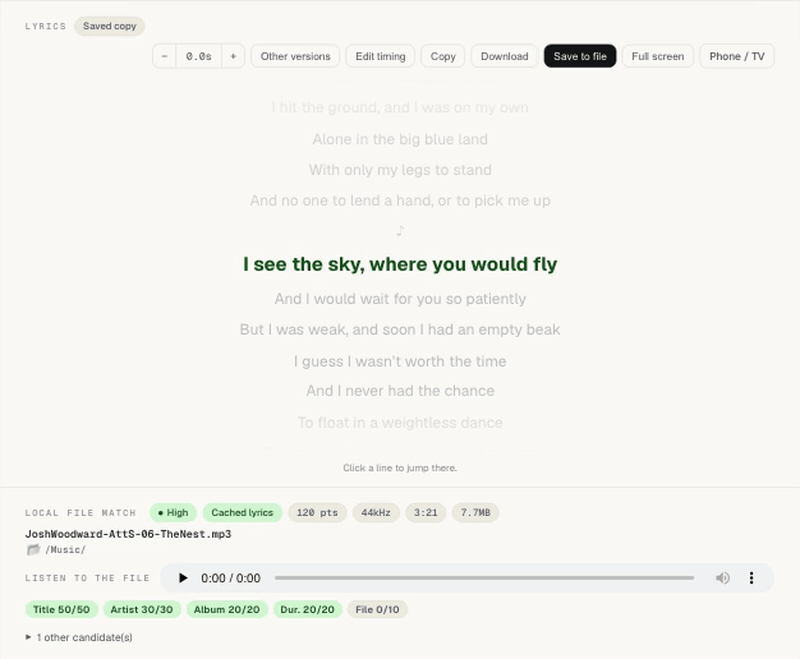
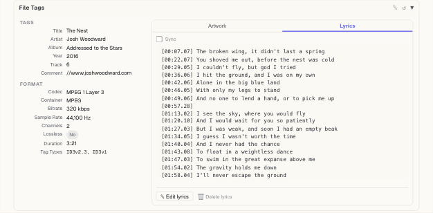
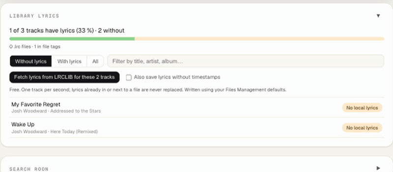
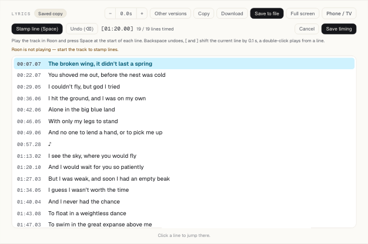
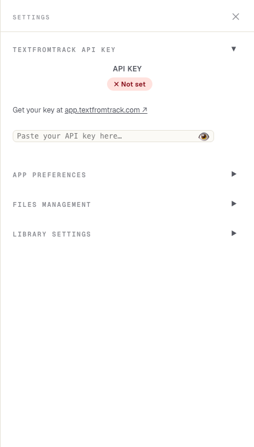
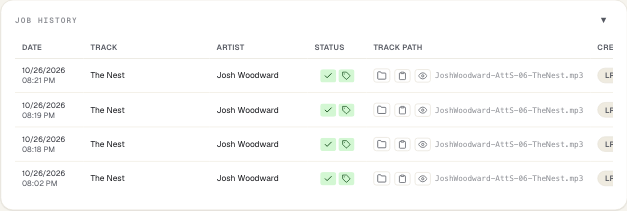

# Your library — lyrics in your own files

*Français : [library.fr.md](library.fr.md) · The player: [player.md](player.md) · Install: [quick start](../quickstart.md)*

The player shows lyrics for everything Roon plays without touching your files. If your music
lives on this computer, a NAS or a drive the companion can reach, point it at that folder and
it can also **write lyrics into the files themselves**: fill the gaps across your whole library,
sync lyrics by hand, and generate the missing ones with AI.

## Point it at your music

Settings (gear icon) → **Library Settings** → add your music folder → **Save & Rescan**.

- On a Mac or PC, use the folder as you see it (for example `/Volumes/Music` for a NAS share).
  In Docker, mount it into the container (`:rw` to write lyrics) and add the path inside the
  container, such as `/music`.
- The scan reads each track's tags and keeps an index; the status line shows how many tracks
  it found and when. Rescan after adding music. A drive that is asleep or unplugged is reported,
  and the previous index is kept.
- Only MP3 and FLAC files can receive lyrics in their tags; other formats get a `.lrc` file.

**On a Mac**, the first scan of a network share or an external drive makes macOS ask whether
*TextFromTrack Companion* may access files on that volume: click **Allow**. Until you answer, the
scan waits, and Library Settings says so. If you missed the dialog: System Settings → Privacy &
Security → Files and Folders → TextFromTrack Companion → turn on *Network Volumes* (or *Removable
Volumes*). The app isn't signed by Apple yet, so macOS asks again after each update.

**Files Management** decides how lyrics are written:

| Option | What it does |
|---|---|
| Embed [LYRICS] tag | Writes the lyrics into the file's tags (MP3 ID3v2, FLAC Vorbis comment). The default when nothing else is chosen. |
| Save .org backup | Copies the original to `Track.mp3.org` / `Track.flac.org` before the first change. On by default. |
| Save LRC file next to audio source | Writes a `Track.lrc` beside the track, for players that read them. |
| Save LRCLIB lyrics automatically | When the playing track has no lyrics and LRCLIB has synced ones, writes them without asking. Off by default. |

**Roon and your lyrics.** Roon reads lyrics embedded in your files' tags: in Roon, Settings →
Library → Import settings, set *Lyrics* and *Synchronized lyrics* to **Prefer file**, then let Roon
rescan. Don't count on Roon reading `.lrc` files beside the tracks.

## The playing track and its file

When the track Roon plays is in your library, the player shows the matched file under the
lyrics: name, folder, format, and a confidence badge. **Listen to the file** plays it in your
browser, to be sure it's the right one.

The match compares title, artist, album, duration and file name (hover a score to see how it
counts). With a *medium* or *low* match, check the file before saving; AI generation asks you to
confirm. **Other candidates** lets you pick another file.

## Save lyrics into the file

With a matched file, **Save to file** writes the lyrics shown — with your timing correction
applied — into the track. The badge turns to *In file tags*, and Roon shows them after its next
rescan. **File Tags** under the match shows what the file now contains: its tags, its artwork
and its lyrics, which you can also edit or remove there.

## Fill the whole library

The **Library lyrics** card counts the tracks that have lyrics (in their tags or in a `.lrc`
file) and those that don't. Filter with *Without lyrics / With lyrics / All* or search by title,
artist or album, then **Fetch lyrics from LRCLIB for these tracks**.

- It runs in the background, one track per second, and you can stop it.
- It **never replaces** lyrics a file already has.
- Lyrics without timestamps are skipped unless you tick *Also save lyrics without timestamps*.
- When LRCLIB is busy it waits and tells you; the summary counts what was saved, not found,
  skipped or failed. (Batch saves stay out of Job History, so a big library doesn't flood it.)

## Sync lyrics yourself

LRCLIB has the words but not the timing? Or the timing is off? **Sync lyrics** (plain lyrics) or
**Edit timing** (synced lyrics) opens the editor. Play the track in Roon and press **Space** at
the start of each line.

| Key | Does |
|---|---|
| Space | Stamps the current line with the playback time and moves to the next |
| Backspace | Undoes the last stamp |
| [ and ] | Shift the current line by 0.1 s |
| ↑ and ↓ | Move to the previous or next line |
| Double-click a line | Plays from that line |
| Esc | Leaves the editor without saving |

**Save timing** keeps the result as the track's lyrics; with a matched file, **Save to file**
then writes them into the track.

## AI lyrics for the rest

For songs no one has transcribed, [TextFromTrack](https://app.textfromtrack.com) listens to the
file and writes synced lyrics. Create an API key there, paste it in Settings → **TextFromTrack
API Key**, and **Generate lyrics with TextFromTrack** appears under the matched file. It uses
credits from your TextFromTrack account (the balance shows in Settings); the result is saved
with your Files Management options and listed in Job History.

## Job History

Every lyrics save from the player — LRCLIB, AI, automatic — is a line in **Job History**: when,
which track, where the lyrics came from, and buttons to view or copy them, open the folder, or
retry.

## Good to know

- **Undo a write:** rename `Track.mp3.org` back to `Track.mp3` (or `.flac`).
- **Docker:** a music volume mounted `:ro` can be read but not written — the error says so.
- **Large libraries** scan in the background; the UI and Roon keep working meanwhile.
- **Your tags are safe:** writing lyrics changes only the lyrics frame (MP3) or the LYRICS comment
  (FLAC); every other tag and the artwork are copied as they were, and checked after the write.
- **Screenshot mode** (App Preferences) hides your folders: paths show as `/Music/…`.

---

*Screenshots show songs by Josh Woodward — "The Nest", "My Favorite Regret", "Wake Up" — licensed
CC BY 4.0. Free download: https://www.joshwoodward.com/. Not affiliated with Roon Labs.*
