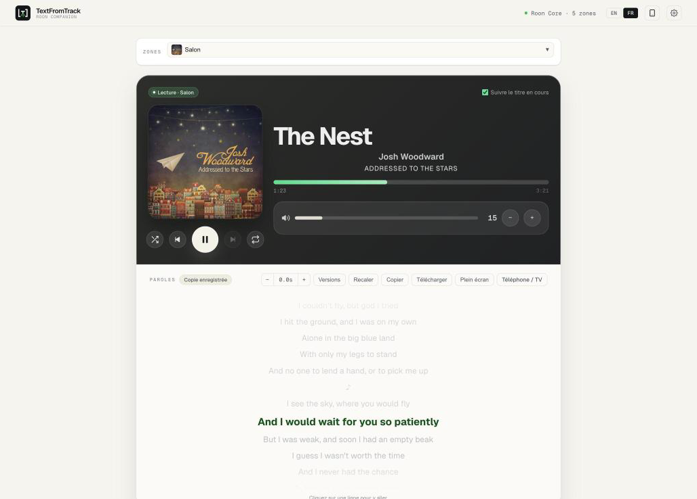
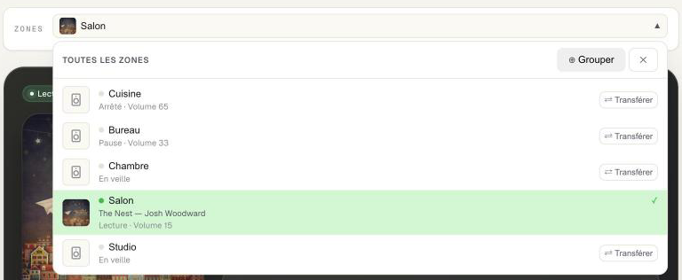
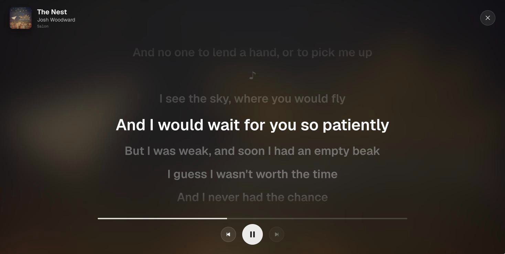
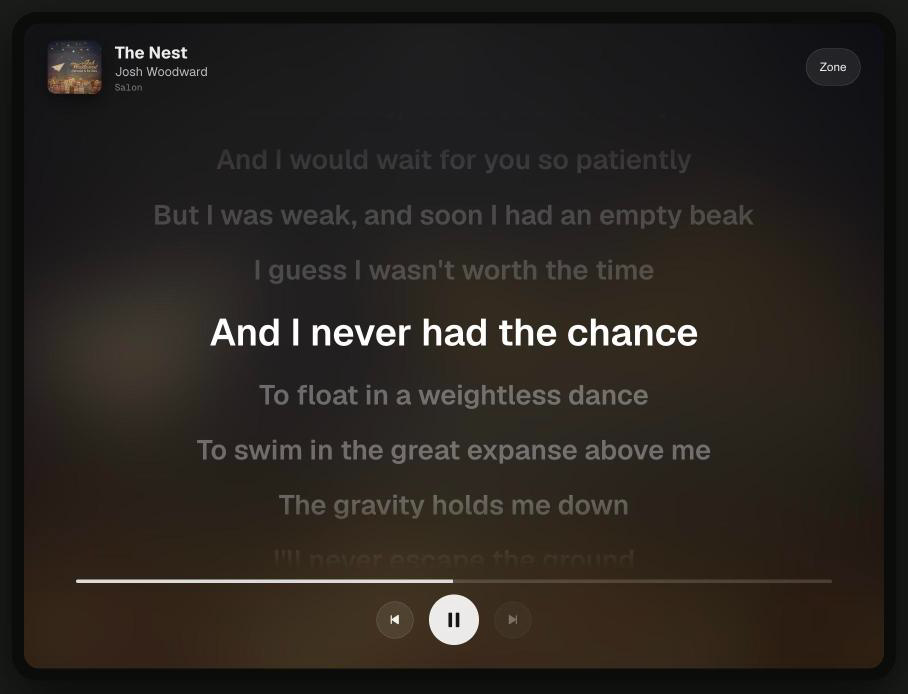

# Le lecteur — les paroles synchronisées de tout ce que joue Roon

*English: [player.md](player.md) · Votre bibliothèque (fichiers, paroles IA) : [guide complet](../user-guide.md) · Installation : [démarrage rapide](../quickstart.fr.md)*

TextFromTrack Roon Companion suit ce que joue une zone Roon et affiche ses paroles, ligne par ligne,
au rythme de la musique. Il fonctionne avec **tout ce que joue Roon** — Qobuz, TIDAL, radio, vos
propres fichiers — et n'a **besoin d'aucun accès à votre dossier musical**.

## Le lecteur

La carte du haut reflète la zone suivie : pochette, titre, artiste, album, progression, volume et
boutons de lecture (aléatoire, précédent, lecture/pause, suivant, répétition). Tout se passe dans Roon.

| Commande | Effet |
|---|---|
| Barre de progression | Cliquez pour sauter ; au clavier, ← / → avancent de 5 s. |
| Volume | Glissez (souris ou doigt) ou utilisez − / + ; ← / → au clavier. Un volume en dB affiche « dB » ; un volume +/- seulement (télécommande IR) n'a que les deux boutons. |
| Icône haut-parleur | Coupe le son de la zone dans Roon. |
| Répétition | Désactivée → tout → un titre (l'icône porte un 1). |
| Artiste / album | Cliquez pour les chercher dans Roon. |

**Zones.** La barre au-dessus du lecteur indique la zone suivie. Ouvrez-la pour voir toutes les zones
avec la pochette de ce qu'elles jouent, leur état (lecture, pause, veille), les enceintes groupées
et le volume — et pour changer de zone, transférer la file ou grouper des sorties. Cliquez ailleurs
(ou Échap) pour la fermer.

## Les paroles

Sous le lecteur, les paroles du titre en cours. La ligne en surbrillance suit la musique.

| Action | Comment |
|---|---|
| **Aller à une ligne** | Cliquez dessus — Roon s'y place. |
| **Corriger le décalage** | **Décalage − / +** déplace de 0,5 s (− = plus tôt, + = plus tard). Mémorisé pour ce titre ; cliquez sur la valeur pour revenir à zéro. |
| **Une autre version** | **Versions** cherche dans la base de paroles par titre et artiste (modifiables) et vous laisse choisir. |
| **Plein écran** | **Plein écran** ou la touche **F** ; **Échap** pour sortir. De grandes lignes sur la pochette floutée, avec les commandes. |
| **Copier / Télécharger** | Copier le texte, ou télécharger un fichier `.lrc` avec votre décalage appliqué. |

Le badge à côté de *Paroles* indique leur origine : **LRCLIB** (récupérées à l'instant), **Copie
enregistrée** (gardée sur votre ordinateur depuis une lecture précédente), **Fichier .lrc** ou
**Dans les tags** (depuis vos fichiers, voir la [bibliothèque](../user-guide.md)). *Non synchronisées*
signifie sans horodatage : elles s'affichent en texte simple.

**D'où viennent les paroles ?** De [LRCLIB](https://lrclib.net), une base gratuite construite par
la communauté. Le compagnon les cherche au début du titre et en garde une copie : la fois suivante,
c'est instantané. Quand LRCLIB est surchargée, la page l'indique et réessaie seule — ou cliquez sur
**Réessayer**.

## Sur un téléphone, une tablette ou une TV

L'**icône téléphone** en haut ouvre une page avec deux QR codes :

1. **L'app** — toute l'interface sur votre téléphone (elle s'adapte à l'écran).
2. **L'affichage des paroles** — des paroles plein écran pour une tablette posée sur une étagère ou
   le navigateur d'une TV. Chaque écran peut suivre sa propre zone (bouton **Zone**) et reste allumé.

## Quand rien ne s'affiche

| Message | Signification |
|---|---|
| *Activez l'extension dans Roon* | Roon → Paramètres → Extensions → activez *TextFromTrack Roon Companion*. |
| *Recherche de votre Roon Core…* | Le Core n'est pas joignable : même réseau ? Dans Docker, renseignez `ROON_CORE_HOST`. |
| *macOS bloque la connexion* | Réglages Système → Confidentialité et sécurité → Réseau local → autorisez l'app. |
| *Serveur injoignable* | Le compagnon lui-même ne tourne pas (app quittée, conteneur arrêté). |
| *Aucune parole trouvée* | LRCLIB n'a rien pour ce titre — essayez **Versions** avec un titre simplifié. |
| *Instrumental* | LRCLIB indique un titre instrumental. |

## Préférences

Réglages (roue dentée) → **Préférences de l'application** :

- **Thème** — comme le système, clair ou sombre.
- **Mode capture d'écran** — remplace à l'écran votre Core, vos zones, enceintes, compte et dossiers
  par des noms neutres, pour partager des captures sans risque.
- **Pas de volume** et **intervalle de rafraîchissement** du lecteur.

L'app de bureau signale aussi les nouvelles versions et peut vous prévenir à la fin d'un lot ou d'une
transcription IA (barre des menus → *Notifications*).

---

*Les captures montrent des chansons de Josh Woodward — « The Nest », « My Favorite Regret »,
« Wake Up » — sous licence CC BY 4.0. Téléchargement gratuit : https://www.joshwoodward.com/.
Sans lien avec Roon Labs.*
