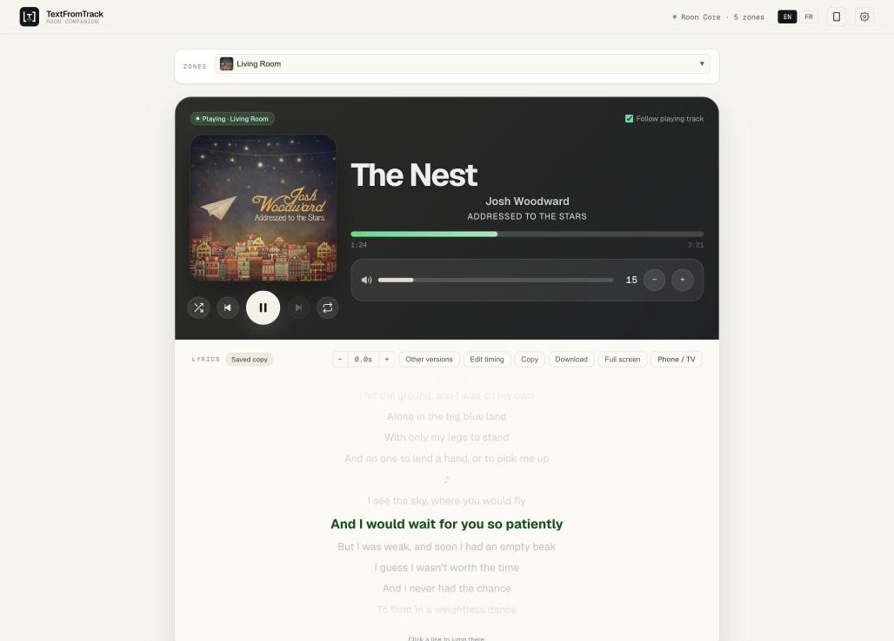
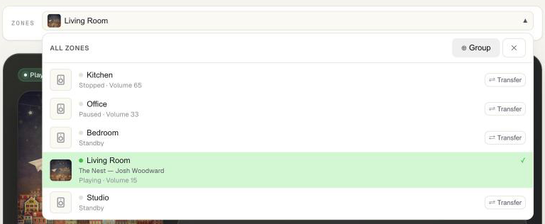
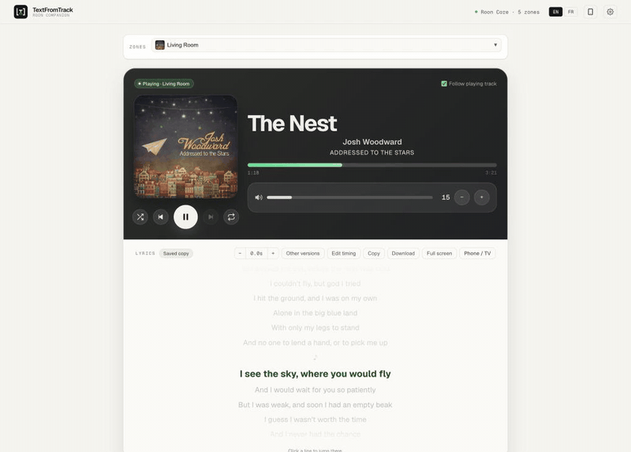
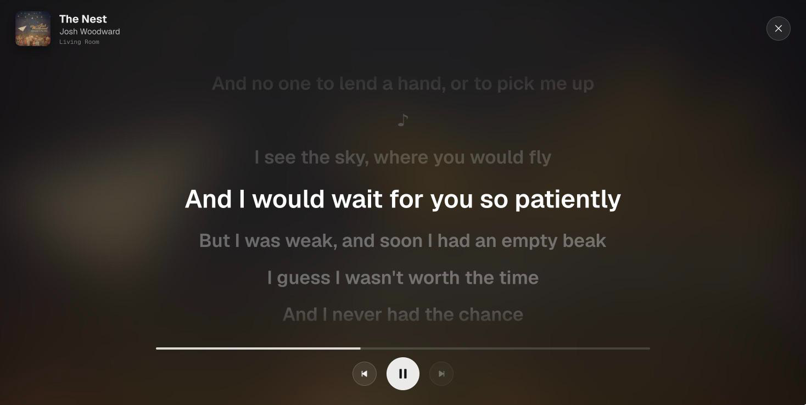
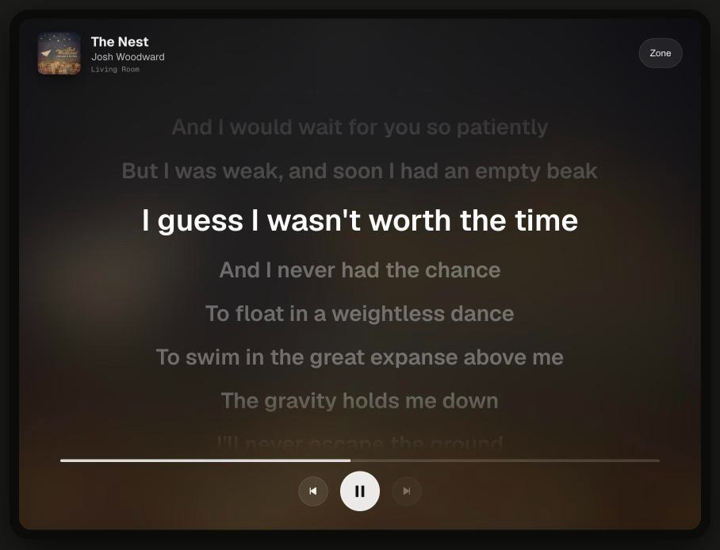

# The player — synced lyrics for everything Roon plays

*Français : [player.fr.md](player.fr.md) · Your library (files, AI lyrics): [full user guide](../user-guide.md) · Install: [quick start](../quickstart.md)*

TextFromTrack Roon Companion follows what a Roon zone plays and shows its lyrics, line by line,
in time with the music. It works with **everything Roon plays** — Qobuz, TIDAL, radio, your own
files — and needs **no access to your music folder**.

## The player

The top card mirrors the zone you follow: cover, title, artist, album, progress, volume and the
transport buttons (shuffle, previous, play/pause, next, repeat). Everything you do here happens in Roon.

| Control | What it does |
|---|---|
| Progress bar | Click to jump; with the keyboard, ← / → move 5 s. |
| Volume | Drag (mouse or finger) or use − / +; ← / → on the keyboard. A volume in dB shows "dB"; a +/- only volume (IR control) gets just the two buttons. |
| Speaker icon | Mutes the zone in Roon. |
| Repeat | Off → all → one (the icon shows a 1). |
| Artist / album | Click to search for them in Roon. |

**Zones.** The bar above the player shows the zone you follow. Open it to see every zone with the
cover of what it plays, its state (playing, paused, standby), grouped speakers and volume — and to
switch, transfer the queue or group outputs. Click anywhere outside (or press Esc) to close it.

## The lyrics

Under the player, the lyrics of the current track. The highlighted line follows the music.

| Action | How |
|---|---|
| **Jump to a line** | Click it — Roon seeks there. |
| **Fix the timing** | **Timing − / +** shifts by 0.5 s (− = earlier, + = later). Remembered for that track; click the value to reset. |
| **Another version** | **Other versions** searches the lyrics database by title and artist (both editable) and lets you pick one. |
| **Full screen** | **Full screen** or the **F** key; **Esc** to leave. Big lines over the blurred cover, with the transport. |
| **Copy / Download** | Copy the text, or download a `.lrc` file with your timing applied. |

The badge next to *Lyrics* says where they come from: **LRCLIB** (fetched just now), **Saved copy**
(kept on your computer from a previous play), **.lrc file** or **In file tags** (from your files,
see [library](../user-guide.md)). *Not time-synced* means the lyrics have no timestamps: they are shown
as plain text.

**Where do lyrics come from?** From [LRCLIB](https://lrclib.net), a free, community-built database.
The companion looks them up when a track starts and keeps a copy, so the next time is instant. When
LRCLIB is overloaded, the page says so and tries again by itself — or press **Retry**.

## On a phone, tablet or TV

The **phone icon** in the top bar opens a page with two QR codes:

1. **The app** — the whole interface on your phone (it adapts to the screen).
2. **The lyrics display** — full-screen lyrics for a tablet on the shelf or a TV browser. Each
   display can follow its own zone (**Zone** button) and keeps the screen awake.

## When nothing shows

| Message | Meaning |
|---|---|
| *Enable the extension in Roon* | Roon → Settings → Extensions → enable *TextFromTrack Roon Companion*. |
| *Looking for your Roon Core…* | The Core isn't reachable: same network? In Docker, set `ROON_CORE_HOST`. |
| *macOS is blocking the connection* | System Settings → Privacy & Security → Local Network → allow the app. |
| *Server unreachable* | The companion itself isn't running (app quit, container stopped). |
| *No lyrics found* | LRCLIB has nothing for this title — try **Other versions** with a simpler title. |
| *Instrumental* | LRCLIB marks the track as instrumental. |

## Preferences

Settings (gear icon) → **App Preferences**:

- **Theme** — same as the system, light or dark.
- **Screenshot mode** — replaces your Core, zone and speaker names, account and folders with
  neutral ones on screen, to share screenshots safely.
- **Volume step** and **refresh interval** of the player.

The desktop app also shows a notice when a new version is out, and can notify you when a batch
or an AI transcription ends (menu bar → *Notifications*).

---

*Screenshots show songs by Josh Woodward — "The Nest", "My Favorite Regret", "Wake Up" — licensed
CC BY 4.0. Free download: https://www.joshwoodward.com/. Not affiliated with Roon Labs.*
