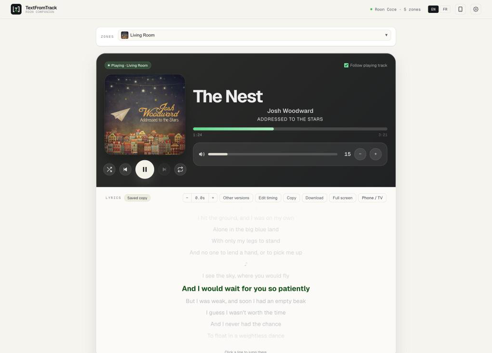
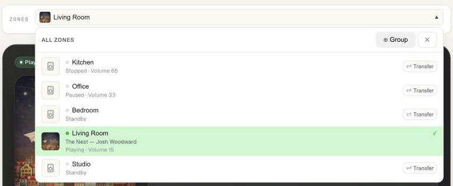
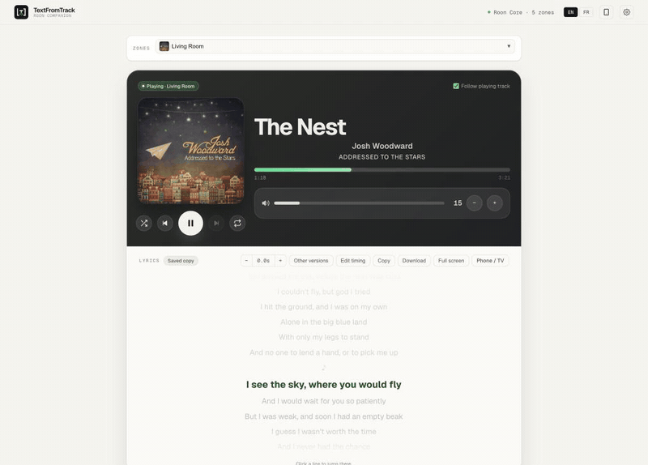
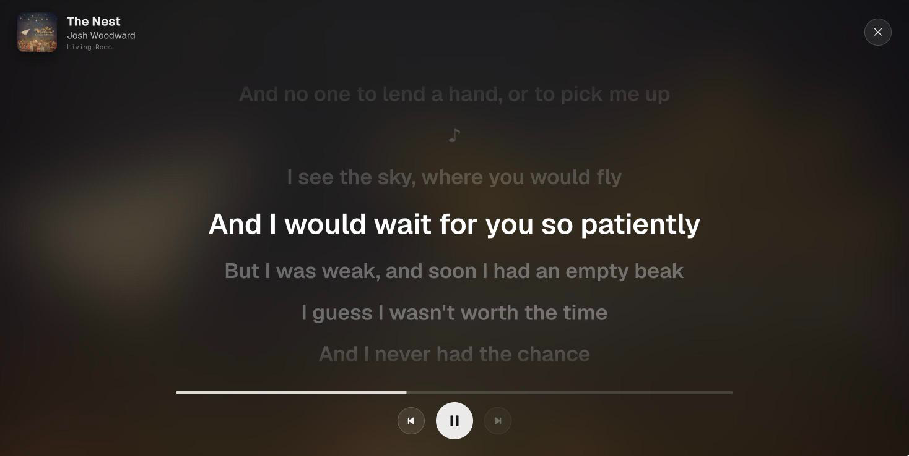
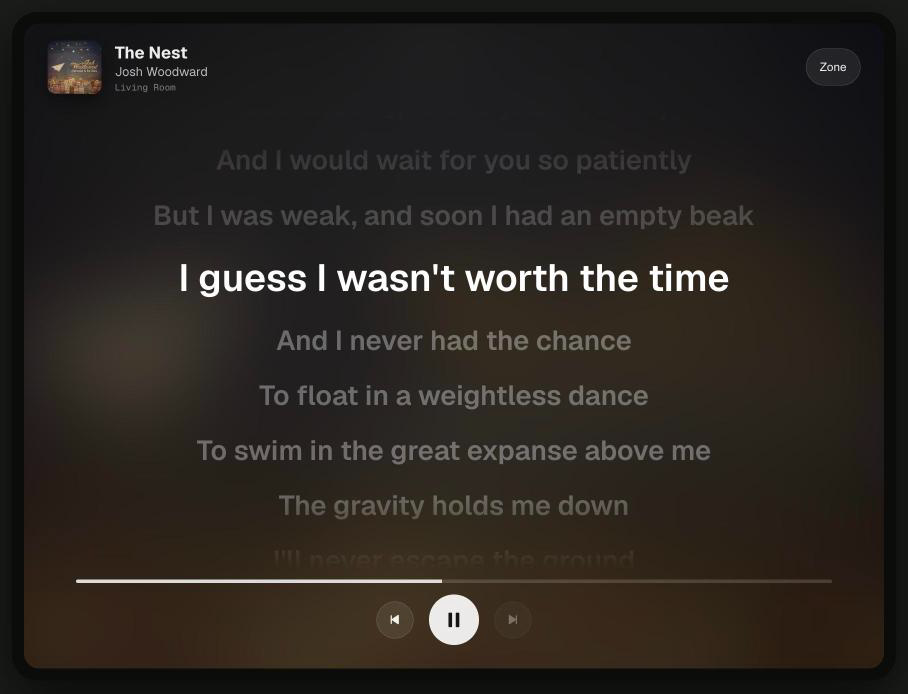

# The player — synced lyrics for everything Roon plays

*Français : [player.fr.md](player.fr.md) · Your library (files, AI lyrics): [library.md](library.md) · Install: [quick start](../quickstart.md)*

TextFromTrack Roon Companion follows what a Roon zone plays and shows its lyrics, line by line,
in time with the music. It works with **everything Roon plays** — Qobuz, TIDAL, radio, your own
files — and needs **no access to your music folder**.

## The player

The top card mirrors the zone you follow: cover, title, artist, album, progress, volume and the
transport buttons (shuffle, previous, play/pause, next, repeat). Everything you do here happens in Roon.

| Control | What it does |
|---|---|
| Progress bar | Click to jump; with the keyboard, ← / → move 5 s. |
| Volume | Drag (mouse or finger) or use − / +; ← / → on the keyboard. A volume in dB shows "dB"; a +/- only volume (IR control) gets just the two buttons. |
| Speaker icon | Mutes the zone in Roon. |
| Repeat | Off → all → one (the icon shows a 1). |
| Artist / album | Click to search for them in Roon. |

**Zones.** The bar above the player shows the zone you follow. Open it to see every zone with the
cover of what it plays, its state (playing, paused, standby), grouped speakers and volume — and to
switch, transfer the queue or group outputs. Click anywhere outside (or press Esc) to close it.

## The lyrics

Under the player, the lyrics of the current track. The highlighted line follows the music.

| Action | How |
|---|---|
| **Jump to a line** | Click it — Roon seeks there. |
| **Fix the timing** | **Timing − / +** shifts by 0.5 s (− = earlier, + = later). Remembered for that track; click the value to reset. |
| **What's next** | **Up next** lists the next tracks of the zone's Roon queue, each with what is known of its lyrics (synced, plain, none). Click one to play from there. |
| **Wrong lyrics** | LRCLIB is written by its users, and sometimes holds another song's words. **Wrong lyrics** shows none for this track from now on; the panel then offers **Paste lyrics**, **Other versions**, or **Show anyway** (undo). |
| **Paste lyrics** | When a track has no lyrics, or you marked them wrong: paste the words (plain text, or LRC with timestamps). They're kept for this track, and **Sync lyrics** adds the timing. |
| **Another version** | **Other versions** searches the lyrics database by title and artist (both editable) and lets you pick one. Each version shows its length, best fit first; a greyed length is not the playing track's — another recording (a live take, an edit), whose timing would drift. |
| **Full screen** | **Full screen** or the **F** key; **Esc** to leave. Big lines over the blurred cover, with the transport. |
| **Copy / Download** | Copy the text, or download a `.lrc` file with your timing applied. |

The badge next to *Lyrics* says where they come from: **LRCLIB** (fetched just now), **Saved copy**
(kept on your computer from a previous play), **.lrc file** or **In file tags** (from your files,
see [your library](library.md)). *Not time-synced* means the lyrics have no timestamps: they are shown
as plain text.

**Where do lyrics come from?** From [LRCLIB](https://lrclib.net), a free, community-built database.
The companion looks them up when a track starts — and for the next three tracks of the queue while
the current one plays — and keeps a copy, so the next time is instant. When
LRCLIB is overloaded, the page says so and tries again by itself — or press **Retry**.

## On a phone, tablet or TV

The **phone icon** in the top bar opens a page with two QR codes:

1. **The app** — the whole interface on your phone (it adapts to the screen).
2. **The lyrics display** — full-screen lyrics for a tablet on the shelf or a TV browser. Each
   display can follow its own zone (**Zone** button) and keeps the screen awake.

## The Roon library

The **Roon library** card has two tabs:

- **Search** — your Roon library and streaming services: tracks, albums, artists. Clicking the
  artist or album name in the player fills the search for you.
- **Browse** — Roon's own menus: Library, Playlists, My Live Radio, Internet Radio, Genres…
  Long lists load more with **Show more**; the path at the top goes back.

Pick a zone in *Play on* and press **▶** on an item to choose Play Now, Add Next, Queue or Start
Radio; **›** opens an album, an artist or a playlist.

## Settings inside Roon

In Roon → **Settings → Extensions**, the companion has its own **Settings** page: the address of
the web interface and of the lyrics screen (handy for a phone or a TV), a **default zone** the
companion follows when it starts, and the automatic saving of LRCLIB lyrics into your files.
A zone picked in the web interface still wins until the companion restarts. The page ends with
the companion's version and its GitHub address.

## When nothing shows

| Message | Meaning |
|---|---|
| *Enable the extension in Roon* | Roon → Settings → Extensions → enable *TextFromTrack Roon Companion*. |
| *Looking for your Roon Core…* | The Core isn't reachable: same network? In Docker, set `ROON_CORE_HOST`. |
| *macOS is blocking the connection* | System Settings → Privacy & Security → Local Network → allow the app. |
| *Server unreachable* | The companion itself isn't running (app quit, container stopped). |
| *No lyrics found* | LRCLIB has nothing for this title — try **Other versions** with a simpler title. |
| *Plain text, not synced* | LRCLIB has synced lyrics only for another recording (a live take, another length), or only copies whose accented letters were lost ("j'? prouve"). The clean plain text of the right one is shown rather than lyrics that drift or can't be read; **Other versions** still lets you pick a synced one (damaged copies are marked *Damaged text*). |
| *Instrumental* | LRCLIB marks the track as instrumental. |
| *LRCLIB is unreachable / overloaded* | No LRCLIB server answered; the app tries again every minute. A mirror helps — see *Lyrics Sources* below. |

## Preferences

Settings (gear icon) → **App Preferences**:

- **Theme** — same as the system, light or dark.
- **Screenshot mode** — replaces your Core, zone and speaker names, account and folders with
  neutral ones on screen, to share screenshots safely.
- **Volume step** and **refresh interval** of the player.

Settings → **Lyrics Sources**: the LRCLIB servers lyrics come from, in order of preference —
lrclib.net by default. Add a mirror (a copy of LRCLIB's database on a server you run, e.g.
`http://192.168.1.20:3300`), move it with ↑ ↓, and check it with **Test**. When a server is down,
busy or doesn't have the song, the next one is asked. Each server asked receives the track's title,
artist, album and length. Setting up a mirror, and where the companion keeps the lyrics it found:
[lyrics at home](../lyrics-database.md).

Settings → **About**, at the bottom: the version and the build it was made from (a commit, with
its date), whether a newer version is out, and links to the source code on GitHub, this version's
release notes, this guide and the page to report a problem. Quote the version and build when you
report one.

A notice in the top bar says when a new version is out (`UPDATE_CHECK=false` turns the check off).
The desktop app can also notify you when a batch or an AI transcription ends (menu bar →
*Notifications*).

---

*Screenshots show songs by Josh Woodward — "The Nest", "My Favorite Regret", "Wake Up" — licensed
CC BY 4.0. Free download: https://www.joshwoodward.com/. Not affiliated with Roon Labs.*
